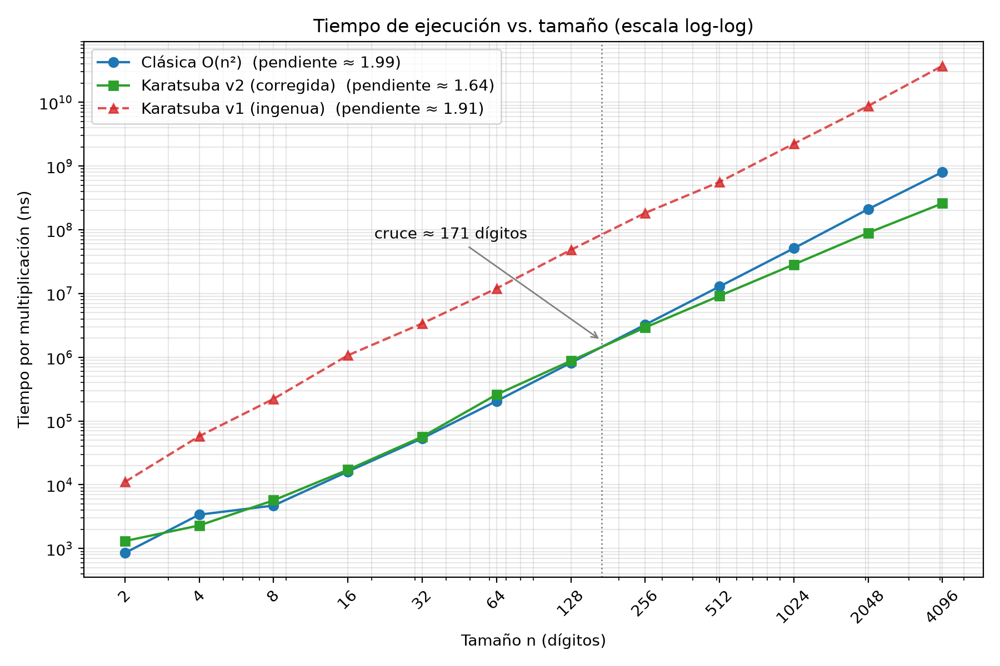

# Práctica 2 — Multiplicación rápida de enteros: Karatsuba

**Asignatura:** Análisis y Diseño de Algoritmos

## Descripción

Implementación y análisis experimental de dos algoritmos de multiplicación de enteros de precisión arbitraria:

| Algoritmo | Complejidad |
|---|---|
| Multiplicación clásica | Θ(n²) |
| Karatsuba (Divide y Vencerás) | Θ(n^log₂3) ≈ Θ(n^1.585) |

Los números se representan en base 10 como cadenas de caracteres (`std::string`). La versión final de Karatsuba usa la multiplicación clásica como caso base para operandos de hasta 32 dígitos (umbral por defecto).

## Integrante

- Camila Garcia Ortiz

## Estructura del proyecto

```
.
├── include/        Archivos de cabecera (.hpp)
├── src/            Implementaciones
│   ├── main.cpp          Menú interactivo
│   ├── testMult.cpp      Pruebas de validación
│   ├── clasica.cpp       Multiplicación clásica
│   ├── karatsuba.cpp     Algoritmo de Karatsuba
│   └── operaciones.cpp   Suma, resta, desplazamiento y partición de cadenas
├── experiments/    Benchmark, datos (.csv) y gráfica
│   ├── benchmark.cpp
│   ├── resultados_v1.csv
│   ├── resultados_v2.csv
│   └── grafica_tiempos.png
└── docs/           Informe
```

## Requisitos

- Compilador con soporte de C++17: `g++` o `clang++`.
- Desarrollado y probado en macOS (x86_64) con `g++` (Apple clang). Debería compilar igual en Linux con `g++`.

No se necesitan librerías externas.

## Compilación y ejecución

Todos los comandos se ejecutan desde la **raíz del proyecto**.

### 1. Programa principal (menú y pruebas de validación)

```bash
mkdir -p bin
g++ -O2 -std=c++17 -Iinclude \
    src/main.cpp src/testMult.cpp src/operaciones.cpp src/karatsuba.cpp src/clasica.cpp \
    -o bin/practica2
./bin/practica2
```

El menú ofrece:

1. **Probar multiplicaciones:** se ingresan dos números y se muestra el producto con ambos algoritmos, indicando si coinciden.
2. **Ejecutar pruebas de validación:** compara la multiplicación clásica con Karatsuba en casos límite (dígitos sueltos, ceros, ceros a la izquierda, ceros intercalados, longitudes impares y un producto de 300 dígitos).
3. **Salir.**

### 2. Benchmark

```bash
mkdir -p bin
g++ -std=c++17 -Iinclude \
    experiments/benchmark.cpp src/operaciones.cpp src/karatsuba.cpp src/clasica.cpp \
    -o bin/benchmark
./bin/benchmark
```

- Debe ejecutarse desde la raíz del proyecto y la carpeta `experiments/` debe existir, porque el programa escribe en `experiments/resultados_v2.csv`.
- Puede tardar unos minutos.
- Para medir tamaños de 2 a 4096 dígitos (potencias de 2), imprime los tiempos en consola y los guarda en el CSV.

> **Sobre la optimización del compilador:** las mediciones del informe se hicieron **sin** `-O2` (por eso el comando de arriba no lo incluye). Para reproducirlas, compila exactamente así. Si agregas `-O2`, los tiempos absolutos cambian y el punto de cruce podría desplazarse.

> **Un solo `main` por ejecutable:** `src/main.cpp` y `experiments/benchmark.cpp` tienen cada uno su propio `main`. No los compiles juntos.

## Metodología del benchmark

- Reloj: `std::chrono::steady_clock`.
- Entradas: dos números aleatorios de n dígitos (`mt19937`, semilla 42), generados fuera del cronómetro; los mismos operandos para ambos algoritmos.
- Repeticiones: se duplican hasta que un lote dure al menos 20 ms; se hacen 5 tandas y se reporta la **mediana** del tiempo por multiplicación.
- El resultado de cada multiplicación se consume (variable `sink`) para que el compilador no elimine el cálculo, y antes de medir cada tamaño se verifica que ambos algoritmos den el mismo producto.

## Resultados

Los datos se guardan en formato CSV con las columnas `n,clasica_ns,karatsuba_ns` (tiempo en nanosegundos por multiplicación):

- `experiments/resultados_v1.csv`: primera implementación de Karatsuba (relleno a potencias de 2 y caso base en n = 1).
- `experiments/resultados_v2.csv`: implementación corregida (la que está en `src/`).

La gráfica de tiempos (escala log-log) se generó a partir de estos CSV con un script de Python (pandas, numpy y matplotlib) que no se incluye en el repositorio; se conserva la imagen final:



**Resumen:** con la implementación corregida, Karatsuba supera a la clásica entre 128 y 256 dígitos (cruce interpolado ≈ 171) y con 4096 dígitos tarda cerca de un tercio del tiempo. La primera versión no mostró cruce en el rango medido. El análisis completo está en el informe.

## Informe

El informe completo se encuentra en `docs/informe.pdf`. Incluye la deducción de Karatsuba, el análisis experimental, las conclusiones, las referencias y la declaración de uso de herramientas de IA.

## Licencia y uso académico

Proyecto desarrollado con fines académicos para la asignatura Análisis y Diseño de Algoritmos.