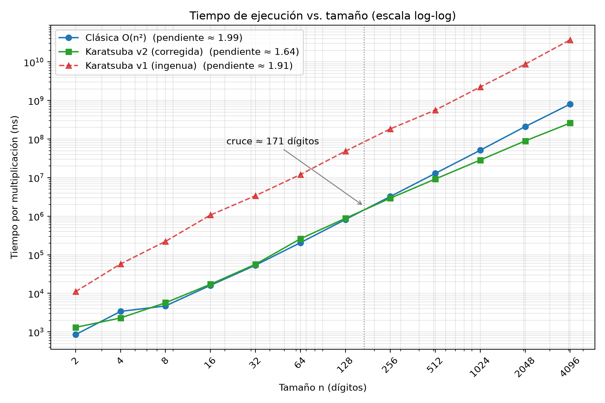

# Informe Práctica 2 Camila García

## Deducción de la identidad de Karatsuba
Para entender la ventaja algorítmica de Karatsuba en la multiplicación de numeros enteros grandes frente a la multiplicación clásica, primero se debe entender el método tradicional.

Para multiplicar dos numeros enteros  $x$ e $y$ de $n$ dígitos en base $B$ (en este caso $B$ = 10), se parten ambos numeros por la mitad ($m = n/2$). 
$x = x_1 \cdot B^m + x_0$ 
$y = y_1 \cdot B^m + y_0$
Siendo $x_1 y y_1$ las primeras mitades del entero y $x_0 y y_0$ las segundas mitades. 
Para multiplicar $x \cdot y$ usando Divide y Vencerás, se reemplaza cada número por su representación descompuesta:
$$x \cdot y = (x_1 \cdot B^m + x_0) \cdot (y_1 \cdot B^m + y_0)$$
De manera en que $x_1$ y $y_1$, al ser las priemeras mitades del número representado, se desplazan m posiciones hacia la izquierda (agregandole m ceros a la derecha) y devolverle su valor real, ya que $x != x_1 + x_0$ Ejemplo: $x = 5842$. $58 + 42 = 100$ pero $58 * 100 = 5800$ y entonces se logra una representación fiel al valor del número $58 + 42 = 5842$

Como resultado de aplicar la propiedad distributiva en la ecuación: $$x \cdot y = x_1 y_1 \cdot B^{2m} + (x_1 y_0 + x_0 y_1) \cdot B^m + x_0 y_0$$, se deben hacer 4 multiplicaciones independientes (2 por cada número) a los productos resultantes para obtener la respuesta. 
1. $x_1 \cdot y_1$ 
2. $x_1 \cdot y_0$ 
3. $x_0 \cdot y_1$ 
4. $x_0 \cdot y_0$ 

Al tener 4 llamadas recursivas de tamaño $n/2$ , recurrencia $T(n) = 4T(n/2) + \Theta(n)$ da una complejidad temporal cuadrática $\Theta(n^2)$. 

Karatsuba consiste entonces en reducir los dos productos cruzados (2. , 3. declarados anteriormente), sumando las mitades altas y bajas de cada número y multiplicando sus resultados, obteniendo únicamente 3 productos $P_1 = x_1 \cdot y_1$ , $P_2 = x_0 \cdot y_0$ y $P_3 = (x_1 + x_0) \cdot (y_1 + y_0)$. 
Desarrollo $P_3$
$$P_3 = (x_1 + x_0)(y_1 + y_0) = x_1 y_1 + x_1 y_0 + x_0 y_1 + x_0 y_0$$
$$P_3 = \underbrace{x_1 y_1}_{P_1} + (x_1 y_0 + x_0 y_1) + \underbrace{x_0 y_0}_{P_2}$$
$$P_3 = P_1 + (x_1 y_0 + x_0 y_1) + P_2$$
Al restar $P_3$ y $(x_1 y_0 + x_0 y_1)$ en ambos lados de la ecuación $$(x_1 y_0 + x_0 y_1) = P_3 - P_1 - P_2$$, se demuestra que el término cruzado es igual a la resta de $P_1 y P_2$ de &P_3$;
$$(x_1 y_0 + x_0 y_1) = P_3 - P_1 - P_2$$. 

Sustituyendo el término central despejado dentro de la fórmula del producto original, se obtiene la identidad de Karatsuba:
$$x \cdot y = P_1 \cdot B^{2m} + (P_3 - P_1 - P_2) \cdot B^m + P_2$$


## Resolución de la recurrencia
Como se explicó anteriormente, el algoritmo de Karatsuba reduce las cuatro multiplicaciones del método clásico a únicamente tres productos independientes: (P_1), (P_2) y (P_3). Esto significa que, al dividir dos números de (n) dígitos por la mitad, se generan 3 llamadas recursivas, cada una trabajando con números de aproximadamente (n/2) dígitos. Adicionalmente deben realizar operaciones como sumas, restas y desplazamientos de dígitos para reconstruir el resultado final que tienen un costo de (\Theta(n)). 
Por lo tanto, la recurrencia que representa el tiempo de ejecución del algoritmo es:
$$
T(n) = 3T\left(\frac{n}{2}\right) + \Theta(n)
$$ 

### Teoréma Maestro 
Forma general: $$ T(n) = aT\left(\frac{n}{b}\right) + f(n)$$

Identificación de parámetros:
$a = 3$: Número de subproblemas recursivos generados en cada paso (los 3 productos $P_1, P_2, P_3$)
$b = 2$: Factor por el cual se reduce la entrada en cada división ($n/2$)
$f(n) = \Theta(n)$: Costo de las operaciones realizadas fuera de las llamadas recursivas (sumas, restas y acomodo de ceros). 

El siguiente paso consiste en calcular (n^{\log_b a}), que permite determinar cómo crece el trabajo generado por las llamadas recursivas:
$$n^{\log_b a} = n^{\log_2 3}$$
Se resuelve el logaritmo y se obtiene:
$$n^{\log_b a} = n^{\log_2 3} \approx n^{1.585}$$

Se debe compara el costo de las operaciones externas a la recursión $f(n)$ con la función límite obtenida $n^{\log_2 3} \approx n^{1.585}$3 : $f(n) = O(n^{\log_2 3 - \varepsilon})$ para $\varepsilon \approx 0.585 > 0$. 
Dado que el exponente $1 < 1.585$, observamos que $f(n) = \Theta(n)$ crece estrictamente más lento que $n^{\log_2 3}$. 

Al cumplirse que (f(n)) crece polinómicamente más lento que (n^{\log_b a}), la recurrencia corresponde al Caso 1 del Teorema Maestro.
Se demuestra formalmente entonces, que el trabajo local $f(n)$ realizado en los niveles superiores es mínimo frente a la enorme cantidad de subproblemas acumulados en el fondo del árbol, por lo que el nivel de las hojas domina el tiempo total. 

$$T(n) = \Theta\left(n^{\log_2 3}\right) \approx \Theta(n^{1.585})$$

### Árbol de recurrencia
Otra manera de resolver la recurrencia consiste en representar gráficamente cómo se distribuye el trabajo de las llamadas recursivas. Para esto se utiliza un árbol de recurrencia, donde cada nodo representa un subproblema y sus hijos representan las nuevas llamadas recursivas generadas.
Número de subproblemas:
En cada división se generan tres nuevos subproblemas, por lo que la cantidad de nodos se multiplica por tres en cada nivel:
Nivel 0: Existe un único problema de tamaño (n).
Nivel 1: Se generan 3 problemas de tamaño (n/2).
Nivel 2: Se generan 9 problemas de tamaño (n/4).
Nivel 3: Se generan 27 problemas de tamaño (n/8).
Siguiendo este comportamiento, en un nivel (i) se tendrá $3^i$ subproblemas.

Cada subproblema en el nivel $i$ tiene un tamaño de $\frac{n}{2^i}$ y realiza un trabajo de sumas/restas de $c \cdot \left(\frac{n}{2^i}\right)$.
Multiplicando la cantidad de subproblemas por el costo de cada uno: $$\text{Costo Nivel } i = 3^i \cdot c \cdot \left(\frac{n}{2^i}\right) = c \cdot n \cdot \left(\frac{3}{2}\right)^i$$

La recursión continúa dividiendo el tamaño de los problemas entre dos hasta alcanzar el caso base, donde el tamaño de cada problema es igual a 1.
Para calcular la altura del árbol, se plantea:
$$\frac{n}{2^h} = 1$$

Despejando:
$$2^h = n$$

Aplicando logaritmo en base 2 a ambos lados:
$$\boxed{h = \log_2 n}$$
Por lo tanto, la altura del árbol de recurrencia es $h = \log_2 n$.

En el nivel final hay $3^h = 3^{\log_2 n}$ subproblemas de caso base, cada uno con costo de $\Theta(1)$, lo que suma un costo de $\Theta(3^{\log_2 n})$. 
Para calcular el costo total del algoritmo, se deben sumar los costos de todos los niveles internos del árbol y el costo correspondiente a las hojas:
$$T(n) = \sum_{i=0}^{\log_2 n - 1} c \cdot n \cdot \left(\frac{3}{2}\right)^i + \Theta(3^{\log_2 n})$$ 
La sumatoria representa una progresión geométrica con razón $1.5$ ($r = \frac{3}{2} = 1.5 > 1$). Al ser una razón mayor que 1, cada nivel tiene un costo mayor que el anterior. Esto significa que el trabajo se va concentrando progresivamente en los niveles inferiores del árbol. 
En toda serie geométrica creciente ($r > 1$), la suma total no se reparte de forma pareja, sino que está dominada por su último término: el nivel de las hojas.
En consecuencia, el costo total del algoritmo queda determinado por:

$$T(n) = \Theta\left(n^{\log_2 3}\right)$$

### Conclusión: ¿Por qué el exponente es $\log_2 3$?
A través de los dos métodos utilizados se obtiene el mismo resultado:

$$\boxed{T(n) = \Theta\left(n^{\log_2 3}\right) \approx \Theta(n^{1.585})}$$

El exponente $(\log_2 3)$ surge directamente de la relación entre la cantidad de subproblemas generados y la profundidad necesaria para resolverlos. Por un lado, en cada nivel del árbol se generan tres nuevos subproblemas ($3^i$), por lo que la cantidad de operaciones recursivas aumenta siguiendo una progresión de base 3. Por otro lado, el tamaño de cada problema se reduce a la mitad, haciendo que la recursión alcance el caso base después de $(\log_2 n)$ niveles.
Al multiplicar la ramificación por la profundidad máxima, el número total de hojas en la base es: $$\text{Total de hojas} = 3^{\log_2 n}$$. Lo que es igual a $$3^{\log_2 n} = n^{\log_2 3} \approx n^{1.585}$$. 

El exponente $\log_2 3$ representa la densidad con la que se multiplican los subproblemas simples en la base del árbol. Dado que el nivel de las hojas domina la suma geométrica total, la cantidad de hojas $n^{\log_2 3}$ fija la complejidad final del algoritmo de Karatsuba. 

## Análisis Experimental 
Para la estructuración y diseño de la fase experimental de este proyecto, se implementó  un entorno de medición controlado, con el fin de seguir los criterios de relevancia, reproducibilidad y equidad para evaluar el comportamiento asintótico real frente al teórico de ambos algoritmos. Kistowski et al. (2015) 
### Montaje 
**Máquina**: MacBook Pro (x86_64), macOS, CPU: 2,3 GHz Intel Core i5 de dos núcleos, 8 GB. 
Reloj: ```std::chrono::steady_clock```.
**Tamaños**: n = 2, 4, 8, …, 4096 dígitos.
**Entradas**: dos números aleatorios de n dígitos (mt19937, semilla 42), generados fuera del cronómetro; los mismos A y B para ambos algoritmos.
**Repeticiones**: se duplican hasta que un lote dure ≥ 20 ms (muy por encima de la resolución del reloj). Se hacen 5 tandas y se reporta la mediana del tiempo por multiplicación.
**Resultado consumido y verificado:** el último dígito de cada producto se acumula en una variable (`sink`) que se imprime al final, para que el compilador no pueda eliminar el cálculo. Además, antes de medir cada tamaño se comprueba que la clásica y Karatsuba devuelven el mismo producto.
**Dos versiones de Karatsuba:**
v1 (ingenua): relleno a potencia de 2 y caso base en n = 1.
v2 (corregida): longitudes arbitrarias y caso base con la multiplicación clásica para n ≤ 32, tras concretar que el método clásico funciona mejor para tamaños pequeños.

En los resultados experimentales obtenidos de la versión ingenua, el algoritmo clásico mantiene un rendimiento superior en todo el rango analizado. El punto de cruce teórico no se manifiesta dentro de este intervalo.

### Tabla de tiempos
> **Nota:** este tabla fue generado con
> asistencia de IA (Claude) a partir de resultados del experimento el primero de noviembre de 2026. 

Tiempo por multiplicación. K/C = tiempo de Karatsuba v2 / tiempo de la clásica (menor que 1 → gana Karatsuba).
 
| n | Clásica | Karatsuba v1 | Karatsuba v2 | K/C (v2) |
|---:|---:|---:|---:|---:|
| 2 | 0.9 µs | 11.1 µs | 1.3 µs | 1.54 |
| 4 | 3.4 µs ⚠ | 57.7 µs | 2.3 µs | 0.68 ⚠ |
| 8 | 4.7 µs | 222.2 µs | 5.7 µs | 1.21 |
| 16 | 16.1 µs | 1.07 ms | 17.2 µs | 1.07 |
| 32 | 53.5 µs | 3.39 ms | 56.6 µs | 1.06 |
| 64 | 205.2 µs | 12.01 ms | 259.4 µs | 1.26 |
| 128 | 818.0 µs | 48.33 ms | 878.3 µs | 1.07 |
| **256** | 3.24 ms | 183.44 ms | 2.93 ms | **0.90** |
| 512 | 12.87 ms | 562.05 ms | 9.18 ms | 0.71 |
| 1024 | 51.24 ms | 2,237.61 ms | 28.53 ms | 0.56 |
| 2048 | 210.47 ms | 8,747.61 ms | 89.55 ms | 0.43 |
| 4096 | 805.24 ms | 37,350.30 ms | 259.46 ms | 0.32 |
 
⚠ El valor de la clásica en n = 4 es un dato atípico (ruido del sistema; en la otra corrida fue 1.7 µs), por lo que no se interpreta como un cruce.
 

 
### Interpretación del punto de cruce 
**Karatsuba v2:** sí hay cruce, entre n = 128 y n = 256. Hasta n = 128 la clásica es igual o más rápida; desde n = 256 Karatsuba gana y la ventaja crece: en n = 4096 tarda un tercio del tiempo (K/C = 0.32). Como solo se midieron potencias de 2, se reporta como intervalo, no como valor exacto.
**Karatsuba v1: no hay cruce en el rango medido.** Es entre 43 y 66 veces más lenta que la clásica en todos los tamaños y su pendiente (1.91) es casi cuadrática. Esto a causa de la implemenación ingenua en la que se desaprovecha la ventaja matemática del algoritmo. cada vez que el código calculaba el término medio, llamaba a la función principal pública en lugar de mantenerse en la secuencia recursiva interna. Esto provocaba que en cada subdivision intermedia los números se normalizaran y se rellenaran rígidamente con ceros a la izquierda para forzarlos a ser potencias de 2 ($2^k^$). Al hacer esto, los subproblemas que debían reducirse a la mitad del tamaño ($n/2$) terminaban agrandándose nuevamente, haciendo que el árbol de llamadas creciera exponencialmente y degradando la complejidad práctica a un comportamiento cuadrático. Además, obligar a la recursión a bajar hasta el caso base estricto de $n=1$ saturó la memoria con cientos de miles de llamadas y cadenas de texto innecesarias, convirtiendo a la versión 1 en un algoritmo extremadamente pesado que nunca logró superar al método clásico.

A Karatsuba le pesa su propia estructura. Para multiplicar dos números con pocos dígitos, gasta más tiempo creando pedazos de texto (substrings), pidiéndole memoria RAM al sistema operativo y haciendo llamadas recursivas que el tiempo que le tomaría hacer una multiplicación directa. Por eso, con números pequeños, Karatsuba pierde contra el método clásico 

Con n pequeño, el ahorro de multiplicaciones es poco la constante del costo de operaciones adicionales (sumar, restar, partir...) domina; con n grande, la diferencia entre $n^2$ y $n^1.585$ supera esa constante y Karatsuba gana. Por eso el punto de cruce no es una propiedad del algoritmo: depende de la implementación, el compilador y la máquina.

## Conclusiones y dificultades

Los resultados experimentales confirman que Karatsuba supera a la multiplicación clásica cuando los números son suficientemente grandes, pero también muestran que esa ventaja depende de la implementación. En la versión corregida (v2, con umbral 32) el punto de cruce apareció entre 128 y 256 dígitos, con una interpolación de aproximadamente 171, y a partir de ahí la ventaja crece con cada duplicación del tamaño hasta que, con 4096 dígitos, Karatsuba tarda cerca de un tercio del tiempo de la clásica. Los exponentes empíricos respaldan este comportamiento: la pendiente medida en escala log-log fue de aproximadamente 1.99 para la clásica, muy cercana al O(n²) teórico, y de 1.64 para Karatsuba, cercana al O(n^1.585) esperado. Por debajo del cruce, la clásica resulta igual o más rápida porque las constantes ocultas de Karatsuba (las copias de strings y las asignaciones de memoria en cada llamada recursiva) pesan más que el ahorro de multiplicaciones cuando n es pequeño. 

Con las dos implementaciones del algoritmo se deja concluir también que una implementación correcta no es necesariamente eficiente. La versión inicial devolvía resultados correctos, pero al rellenar a potencias de 2 el subproblema del medio no se reducía a la mitad, lo que rompía la recurrencia T(n) = 3T(n/2) + O(n); por eso se comportó como un algoritmo casi cuadrático. Al corregir el relleno y usar la clásica como caso base para tamaños pequeños, la misma idea algorítmica pasó a ser más de 140 veces más rápida con 4096 dígitos. En conjunto, la complejidad asintótica permite predecir quién gana para n grande y cómo crecen las curvas, pero el punto exacto en que ocurre el cruce lo determinan las constantes, el manejo de memoria, el compilador y la máquina, por lo que no es una propiedad del algoritmo sino de su implementación. Las mediciones se hicieron en una sola máquina y sin optimización del compilador, así que los valores absolutos y el cruce podrían variar al ser repetidas en otro entorno. 

## Referencias

Chauhan, P. (2024, 11 de diciembre). *Understanding and implementing the Karatsuba multiplication algorithm for large numbers*. DEV Community. https://dev.to/frorning/understanding-and-implementing-the-karatsuba-multiplication-algorithm-for-large-numbers-2dj4

GeeksforGeeks. (2021, 25 de marzo). *std::mt19937 class in C++*. https://www.geeksforgeeks.org/cpp/stdmt19937-class-in-cpp/

Kistowski, J. v., Arnold, J. A., Huppler, K., Lange, K.-D., Henning, J. L., & Cao, P. (2015). How to build a benchmark. En *Proceedings of the 6th ACM/SPEC International Conference on Performance Engineering (ICPE '15)* (pp. 333–336). ACM. https://doi.org/10.1145/2668930.2688819

Enunciado: *ADA_Practica2_DyV.pdf* (curso ADA).

*ADA_Tema4_DivideAndConquer.pdf*(curso ADA)


## Uso de IA

Fechas de consulta: 30 de octubre al 2 de noviembre de 2026.

| Componente | Herramienta | Fecha | Propósito declarado |
|---|---|---|---|
Comprensión teórica del algoritmo de Karatsuba | NotebookLM (Google) | 30 de octubre de 2026 | Se cargaron las fuentes de la clase como material de consulta y se solicitó una explicación detallada del algoritmo de Karatsuba en relación con lo visto en clase. |
| Algoritmo de Karatsuba, estructura del proyecto y menú del `main` | GPT-5.6 Luna (OpenAI) | 30 de octubre de 2026 | Resolución de dudas sobre el algoritmo para comparar dos enteros y determinar cuál es mayor; apoyo con el algoritmo de Karatsuba en los casos en que m % 2 ≠ 0 y con la estructura del algoritmo; apoyo con la estructuración del proyecto; resolución de errores de compilación; creación del menú del `main`. |
| Benchmark y experimentos de medición de tiempos | Claude (Anthropic) | 31 de octubre al 1 de noviembre de 2026 | Resolución de dudas sobre el benchmark; optimización de la función de generación de números aleatorios; apoyo en el desarrollo del código para los experimentos de medición de tiempos; análisis de resultados y cambios en la implementación para la segunda prueba. |
| Informe: análisis experimental, conclusiones y referencias | Claude Sonnet 5.5 (Anthropic) | 1 al 2 de noviembre de 2026 | Corrección de errores de la implementación (`return` faltante en el caso base de Karatsuba y producto nulo con ceros a la izquierda en la multiplicación clásica); generación de codigo para generacion de la gráfica log-log de tiempos; apoyo en redacción del análisis experimental y generación de tablas (montaje, tabla de tiempos), de las secciones de referencias y uso de IA.


